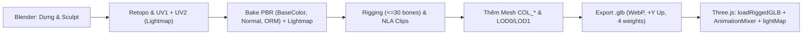

# 🎨 Tài Liệu Đặc Tả Thiết Kế 3D Bằng Blender — Cuộc Phiêu Lưu Của Mây

Tài liệu này liệt kê chi tiết toàn bộ những gì cần thiết kế, dựng hình, gắn xương (rigging), làm hoạt ảnh (animation), nướng ánh sáng (baking) và xuất `.glb` trong **Blender 4.x** để nâng cấp **Cuộc Phiêu Lưu Của Mây** từ mức dựng khối bằng code (`6.55 / 10`) lên chuẩn game 3D indie hoàn chỉnh (`8.5 – 9.0+ / 10`) mà vẫn chạy mượt offline trên trình duyệt (WebGL + PWA).

---

## 1. Quy Chuẩn Kỹ Thuật & Ngân Sách WebGL (Bắt Buộc Trước Khi Dựng)

> [!IMPORTANT]
> Game chạy trực tiếp trên trình duyệt bằng **Three.js + Service Worker PWA offline** (không cài bộ giải mã WASM ngoài nếu không cần). Mọi file `.glb` xuất từ Blender phải tuân thủ đúng quy chuẩn dưới đây để không làm sụt FPS hoặc phình dung lượng tải trang.

### 1.1. Tỷ lệ, Trục tọa độ & Gốc (Origin)
| Hạng mục | Quy chuẩn trong Blender | Lý do khớp với Three.js |
| :--- | :--- | :--- |
| **Đơn vị tỷ lệ** | `1 unit = 1 mét` (Mây cao `1.45 m`, cửa nhà cao `2.2 m`) | Khớp trực tiếp tốc độ chạy, độ cao nhảy & camera trong `js/player.js` |
| **Apply Transform** | Bắt buộc `Ctrl + A -> All Transforms` trước khi rig/xuất | Tránh lỗi méo xương, lật mặt pháp tuyến và lệch collider |
| **Điểm gốc (Origin)** | Nhân vật & công trình: đặt tại **giữa đáy chân `(0, 0, 0)`** Sinh vật bơi/bay: đặt tại **tâm khối lượng** | Đặt thẳng lên `ctx.groundH(x, z)` không bị chìm hay lơ lửng |
| **Hướng mặt (Forward)** | Quay mặt nhân vật/thú/Boss về **`-Y` trong Blender** (nhìn thẳng vào góc `Numpad 1 Front View`) | Chuẩn xuất glTF (`+Y Up`): vào Three.js sẽ quay chuẩn về `+Z` (thống nhất 1 chiều duy nhất cho mọi model mới) |
| **Chất liệu & Ánh xạ** | Dùng duy nhất **Principled BSDF** (không dùng shader procedural phức tạp của Blender mà chưa bake) | Exporter glTF 2.0 chỉ giữ nguyên được Principled BSDF + ảnh texture |

### 1.2. Ngân sách Đa giác, Xương & Dung lượng
| Nhóm tài sản | Tam giác (Tris) tối đa | Số xương (Bones) | Số Material | Texture |
| :--- | :---: | :---: | :---: | :---: |
| **Nhân vật chính (Mây)** | `4.500 – 7.500` | `26 – 30` (≤ 4 weights/đỉnh) | `2` (Thân/Tóc + Mặt) | `1024×1024` (WebP/JPG) |
| **NPC cốt truyện & Bạn đồng hành** | `1.500 – 3.000` | `10 – 18` | `1` | `512×512` |
| **6 Trùm (Boss)** | `3.500 – 6.000` | `16 – 26` | `1 – 2` | `1024×1024` |
| **Công trình lớn (Landmark)** | `3.000 – 8.000` | `0` (trừ cánh quạt xoay) | `1 – 2` (Trim Sheet) | `1024×1024` + Lightmap `512×512` |
| **Cây / Đá / Đạo cụ lặp lại** | LOD0: `600 – 1.500` LOD1: `200 – 500` | `0` | `1` (Atlas dùng chung) | `512×512` |
| **Tổng dung lượng cả gói mới** | — | — | — | **Mục tiêu `12 – 22 MB`** (để PWA cache tốt) |

---

## 2. Nhóm 1 — Nhân Vật Chính: Bé Mây (`may_rigged.glb`) *(Ưu tiên #1)*

Đây là mô hình người chơi nhìn thấy **100% thời lượng chơi** và là nguyên nhân chính khiến Tiêu chí #5 hiện chỉ đạt `4.6 / 10`.

### 2.1. Dựng hình & Tỷ lệ nghệ thuật (Stylized Chibi/Ghibli)
- **Tỷ lệ**: Cao `1.45 m`, tỷ lệ đầu : thân khoảng `1 : 2.6`, vai bo mềm, bàn tay có ngón cái + cụm ngón gộp (kiểu *Zelda Wind Waker / Animal Crossing / Genshin Chibi*) để cầm Gậy Phép đẹp mà nhẹ poly.
- **Khuôn mặt có biểu cảm (Shape Keys / Morph Targets)**:
  - `Blink` (chớp mắt tự động mỗi 3–5 giây).
  - `Smile` (cười rạng rỡ khi nhận thưởng / vuốt ve thú).
  - `Surprised` (ngạc nhiên khi Boss xuất hiện).
  - `Talk_Open` (mở miệng nhẹ khi có giọng đọc của Mây).
- **6 Bộ Trang Phục & 6 Trang Bị nằm chung 1 file `.glb`** (để dùng chung 1 bộ xương duy nhất, chỉ ẩn/hiện node trong Three.js thay vì nạp 6 file nặng!):
  - Trang phục (chuyển đổi hiển thị): `Outfit_VayHong`, `Outfit_HaiBim`, `Outfit_MuVang`, `Outfit_BoiBien`, `Outfit_AoAm`, `Outfit_CongChua`.
  - Tóc tương ứng: `Hair_Bui` (búi + nơ), `Hair_HaiBim` (hai bím có xương đuôi lắc nhẹ).
  - Phụ kiện gắn vào xương Socket: `Gear_KinhLan`, `Gear_ChanVit`, `Gear_BinhKhi`, `Gear_CanhMay` (2 xương cánh đập mượt khi lướt ở Màn 6!), `Gear_GayPhep` (Gậy Cầu Vồng có đầu pha lê tách material `Mat_StaffGem` để đổi màu theo 6 nguyên tố!).

### 2.2. Hệ thống Xương (Armature — tối đa 30 xương)
- **Thân trục**: `Root` → `Pelvis` → `Spine` → `Chest` → `Neck` → `Head` (+ `Hair_Tail_L/R` hoặc `Ponytail` để tóc nhún khi chạy).
- **Tay & Chân (2 bên `.L / .R`)**: `Shoulder` → `UpperArm` → `LowerArm` → `Hand`; `Thigh` → `Shin` → `Foot`.
- **Xương Neo (Sockets)** bắt buộc đặt đúng tên:
  - `Socket_Staff` (con của `Hand.R`): điểm đặt Gậy Phép & tâm phát tia phép thuật VFX.
  - `Socket_Back` (con của `Chest`): điểm gắn Bình Khí Lặn & Đôi Cánh Mây.
  - `Socket_HeadTop` (con của `Head`): điểm gắn Mũ Vàng / Vương Miện.

### 2.3. 12 Clip Hoạt Ảnh bắt buộc (lưu dưới dạng NLA Tracks)
| Tên Clip (Action) | Độ dài (30 fps) | Lặp (Loop) | Mô tả chuyển động |
| :--- | :---: | :---: | :--- |
| `Idle` | 60f (2.0s) | Có | Thở nhẹ, nhún vai, tay cầm gậy đung đưa tự nhiên |
| `Walk` | 30f (1.0s) | Có | Bước đi nhí nhảnh, hông lắc nhẹ, váy/tóc nhịp theo |
| `Run` | 20f (0.67s) | Có | Chạy nghiêng người về trước, tay vung dứt khoát |
| `Jump_Start` | 12f (0.4s) | Không | Nhún lấy đà và bật người lên |
| `Fall_Loop` | 20f (0.67s) | Có | Lơ lửng trên không, tay mở nhẹ giữ thăng bằng |
| `Land` | 10f (0.33s) | Không | Chạm đất khuỵu gối nhẹ rồi đứng thẳng |
| `Glide` | 30f (1.0s) | Có | Nghiêng thân lướt gió, Đôi Cánh Mây dang rộng vỗ êm |
| `Swim_Idle` | 45f (1.5s) | Có | Đạp chân nhẹ giữ người dưới nước |
| `Swim_Move` | 30f (1.0s) | Có | Quẫy chân vịt mượt, tay khua nước |
| `Cast_Spell` | 22f (0.73s) | Không | Vung Gậy Phép lên cao rồi chỉ về phía trước (frame 10 là điểm phát phép!) |
| `Interact_Pet` | 28f (0.93s) | Không | Cúi người vươn tay xoa đầu bạn thú / mở rương |
| `Hit_Hurt` | 18f (0.6s) | Không | Giật lùi khi mất Tim Ánh Sáng |
| `Victory` | 50f (1.67s) | Không | Xoay vòng giơ gậy ăn mừng khi nhận Viên Ngọc |

---

## 3. Nhóm 2 — Bạn Đồng Hành & 7 NPC Cốt Truyện (`assets/models/npc_*.glb`)

Không cần dựng riêng lẻ 35 bộ xương tốn sức. Chia làm **2 tầng sản xuất thông minh**:

### 3.1. Tầng A — 9 Nhân vật Xuất hiện Liên tục (Mỗi con 1 Rig riêng, 1.5k – 3k tris)
1. **`companion_milo.glb` (Cún Milo)**: Dáng cún bông mềm, tai rũ có bone lắc, đuôi vẫy, vòng cổ chuông, kèm node `Wing_L / Wing_R` ẩn mặc định (chỉ bật ở Chương 6 thành *Milo Có Cánh*). Clip: `Idle`, `Run`, `Jump`, `Fly`, `Happy`.
2. **`npc_turtle_elder.glb` (Cụ Rùa Già Gác Đèn & Cụ Rùa San Hô Cổ)**: Mai chạm hoa văn lục giác + kính lão / rêu san hô (tách phụ kiện `Acc_Glasses` và `Acc_Coral` để dùng 1 model cho cả Đảo Mây lẫn Chương 1!). Clip: `Idle`, `Talk`, `Nod`.
3. **`companion_bubi.glb` (Cá Heo Bubi — Chương 1)**: Thân cong khí động học mượt, vây đuôi 3 đốt xương uốn sóng thật. Clip: `Swim`, `Jump_Spin`, `Talk`.
4. **`npc_squirrel.glb` (Bà Sóc Hạt Dẻ — Chương 2)**: Đuôi xù to có 3 xương phất phơ, khăn choàng nhỏ, cầm hạt dẻ. Clip: `Idle`, `Talk`, `Hop`, `Celebrate`.
5. **`npc_camel_kiki.glb` (Lạc Đà Nhí Kiki — Chương 3)**: Bướu tròn, yên thảm đỏ tua rua, lông mi dài. Clip: `Idle`, `Talk`, `Walk`, `Happy`.
6. **`npc_owl_maestro.glb` (Nhạc Sư Cú Mèo — Chương 4)**: Lông cánh xếp lớp, kính nhạc sĩ, cầm dùi gõ nhịp. Clip: `Idle`, `Talk`, `Conduct_Wing`, `Celebrate`.
7. **`companion_bibi.glb` (Dơi Nhỏ Bibi — Chương 4)**: Tai to dễ thương, màng cánh có xương gập/xòe, đèn lồng nhỏ đeo chân. Clip: `Fly_Loop`, `Happy`.
8. **`npc_penguin_chief.glb` (Trưởng Làng Cánh Cụt Bông — Chương 5)**: Mũ len + khăn choàng trưởng làng, dáng đi lạch bạch. Clip: `Idle`, `Waddle`, `Talk`, `Belly_Slide`.
9. **`npc_phoenix.glb` (Sứ Giả Phượng Hoàng — Chương 6)**: Cánh 2 tầng lông chuyển màu vàng-hồng-tím, đuôi dài 4 đốt xương uốn lượn như dải lụa. Clip: `Fly_Hover`, `Talk`, `Swoop`, `Celebrate`.

### 3.2. Tầng B — 20+ Loài Thú Phụ Dùng 4 Bộ Xương Chung (Shared Rigs)
Thay vì rig 20 lần, chỉ cần làm **4 bộ xương mẫu** rồi gắn da (skinning) cho các loài cùng họ:
- **Rig 4 chân (`rig_quadruped`)**: Hươu sao, Tuần lộc mũi đỏ, Kỳ lân mây, Cáo sa mạc, Cáo tuyết, Gấu Bắc Cực, Cừu bông. *(Clip chung: `Idle`, `Walk`, `Hop_Happy`)*.
- **Rig chim (`rig_bird`)**: Chim rừng, Chim cầu vồng, Hải âu, Đại bàng, Vẹt, Cú nhỏ. *(Clip chung: `Idle_Perch`, `Fly_Flap`, `Glide`)*.
- **Rig thú nhỏ nhảy (`rig_critter`)**: Thỏ rừng, Thỏ tuyết, Chuột chũi đèn, Bọ cánh cứng, Cua đỏ. *(Clip chung: `Idle`, `Hop`, `Wave`)*.
- **Sinh vật biển**: Giữ lại và làm sạch UV/roughness cho **15 model `.glb` Màn 1** hiện có (`turtle`, `manta`, `jelly`, `fish`, `tang-*`, `coral`...).

---

## 4. Nhóm 3 — 6 Trùm Sương Xám & Quái Vật (`assets/models/boss_*.glb`)

Mỗi Trùm cần thiết kế rõ **điểm yếu hình ảnh (Visual Weakpoint)** để người chơi nhìn là hiểu ngay phải dùng phép nào, đồng thời tái sử dụng làm **Quái thường** (thu nhỏ `0.45×`, bỏ vương miện/giáp đặc biệt).

| File `.glb` | Nhân vật & Chi tiết điêu khắc cần có trong Blender | Node đặc biệt cho cơ chế game | 6 Clip Animation chuẩn |
| :--- | :--- | :--- | :--- |
| `boss_kraken.glb` | **Bạch Tuộc Mực Khổng Lồ** (Ch1): Đầu phồng có vương miện vỏ ốc vỡ, 8 xúc tu có giác hút, mắt phát sáng đỏ | `Socket_Mouth` (bắn Ngọc Trai Đen) | `Intro_Roar`, `Idle_Float`, `Windup_Spit`, `Attack_Slam`, `Stun_Hurt`, `Defeat_Shrink` |
| `boss_mushroom.glb` | **Vua Nấm Khô Héo** (Ch2): Thân vặn xoắn như gốc cây mục, mũ nấm nứt có gai tím & lớp bùn đen phủ trên mũ | `Layer_MudShield` (ẩn khi trúng `🌊` rửa bùn!) | `Intro_Roar`, `Idle`, `Jump_Windup`, `Ground_Slam`, `Stun_Clean`, `Defeat_Bloom` |
| `boss_scorpion.glb` | **Bọ Cạp Sa Mạc** (Ch3): Giáp đốt cát vàng-tím, 2 càng lớn, 6 chân có khớp, đuôi 5 đốt chĩa kim tinh thể | `Node_TailTip` (phát tia / lao chích) | `Intro_Roar`, `Idle`, `Burrow_Prep`, `Dash_Strike`, `Stun_Flip`, `Defeat` |
| `boss_golem.glb` | **Golem Pha Lê Khổng Lồ** (Ch4): Cơ thể đá đen ghép khối bất đối xứng, khe nứt phát sáng tím bên trong | `Layer_DarkArmor` (vỡ/ẩn khi trúng `💎` để lộ lõi `Core_Crystal` cho `☀️` chiếu!) | `Intro_Assemble`, `Idle`, `Boulder_Throw`, `Stomp`, `Armor_Broken_Stun`, `Defeat_Purify` |
| `boss_icewolf.glb` | **Sói Tuyết Băng Giá** (Ch5): Dáng sói dũng mãnh, bờm kết tinh băng nhọn dọc sống lưng & đuôi pha lê | `Mane_Frost` (đổi màu trắng xanh thuần khiết khi thanh tẩy) | `Intro_Howl`, `Idle`, `Prowl_Prep`, `Charge_Slide`, `Crash_Dizzy`, `Defeat` |
| `boss_stormking.glb` | **Vua Mây Bão / Bóng Xám** (Ch6): Thân mây xoáy u tối, áo choàng rách tả tơi, vương miện tia chớp vàng | `Layer_StormShield` (vỡ ở Pha 1), `Layer_Vines` (trói ở Pha 3) | `Intro_Descend`, `Idle_Hover`, `Summon_Lightning`, `Drop_Floor`, `Trapped_Struggle`, `Launch_Sky_Spin` |

---

## 5. Nhóm 4 — 7 Công Trình Điểm Nhấn (Landmarks) & Đạo Cụ Giải Đố

Đây là nhóm trực tiếp nâng **Tiêu chí #2 (từ 5.5 lên 8.5+)** và xóa sạch lỗi đi xuyên vật thể (**Tiêu chí #7**).

### 5.1. Danh sách Công trình chính (Hero Landmarks)
| Màn | File `.glb` | Chi tiết điêu khắc cần có thay thế khối hộp hiện tại | Node tương tác / Tách rời |
| :---: | :--- | :--- | :--- |
| **Hub** | `lm_lighthouse.glb` | Tháp hải đăng gạch đá vát cạnh (bevel), bậc thang xoắn ngoài chân tháp, ban công sắt uốn, mái vòm đồng xanh, 3 cửa sổ tròn có khung kính sâu | `Slot_Gem_1..6` (6 hốc đặt Ngọc Cầu Vồng), `Beacon_Pivot` |
| **Hub** | `lm_cabin.glb` | Nhà gỗ mái ngói xếp lớp không đều, ống khói đá cuội, hiên gỗ, chậu hoa cửa sổ, khung ảnh Mây gỗ chạm khắc | `Door_Frame` |
| **Hub** | `lm_pier_boat.glb` | Bến đá có vết nứt/rêu mép nước, ván cầu gỗ cong nhẹ, cọc neo quấn dây thừng, thuyền gỗ đóng ván cong + mui vải | `Boat_Root` (tách để dập dềnh theo sóng) |
| **Ch1** | `lm_shipwreck.glb` | Xác tàu gỗ cướp biển vỡ đôi, sườn tàu cong lộ ra, cột buồm gãy phủ rong rêu, bánh lái cổ | `Treasure_Spot` |
| **Ch2** | `lm_mother_tree.glb` | Thân đại thụ xoắn rễ bám đất tự nhiên (sculpt), hốc cửa cổ tích hình vòm có tay nắm & đèn treo, tán cành phân tầng tự nhiên | `Canopy_Dead` & `Canopy_Alive` (chuyển đổi khi hồi sinh!) |
| **Ch2** | `lm_wood_bridge.glb` | Cầu gỗ cong kiểu rừng cổ tích, cột gỗ thô buộc dây thừng, ván cầu có độ dày & khe hở nhẹ | `COL_Bridge_Walk` (mesh mặt đi bộ chính xác) |
| **Ch3** | `lm_pyramid.glb` | Kim tự tháp đá khối có vết mòn cạnh + bậc thang mặt trước + cổng đá có chữ tượng hình + 2 cột Obelisk + chóp vàng Pyramidion | `Seal_Gate` (cổng phong ấn tan biến khi 3 laser hội tụ) |
| **Ch4** | `lm_crystal_arena.glb` | Cầu đá cổ chạm phù điêu + Đấu trường tròn viền rune pha lê + 4 vòm cột đá cắm xuống hồ | `COL_Arena_Walk` |
| **Ch5** | `lm_igloo.glb` | Lều tuyết xếp khối băng so le có mạch vữa tuyết thật, cửa vòm sâu có rèm vải & ánh lửa ấm bên trong | — |
| **Ch5** | `lm_snowman.glb` | Người tuyết điêu khắc mềm mại, khăn len dệt, mũ phớt nhăn tự nhiên, tay cành cây thật, nút than | — |
| **Ch6** | `lm_rainbow_castle.glb` | Lâu đài cổ tích phong cách *Disney/Ghibli*: tháp tròn + cửa sổ kính màu Gothic, tường châu mai có phào chỉ, cổng vòm đôi, cờ lụa | `Flags_1..4` (bone hoặc vertex wave) |
| **Ch6** | `lm_windmill.glb` | Cối xay gió tường đá + khung gỗ chữ thập + cánh vải buồm căng gió | `Windmill_Blades` (tách tâm quay chuẩn) |

### 5.2. Đạo cụ Giải đố Cốt truyện (Props tương tác)
- **`prop_dead_tree.glb`**: Cây cổ thụ chết/hồi sinh (2 trạng thái + nấm lò xo mọc ở gốc).
- **`prop_solar_mirror.glb`**: Đài gương Ai Cập cổ, tách riêng `Mirror_Dish` để xoay hướng về Kim Tự Tháp.
- **`prop_cracked_wall.glb`**: Tường pha lê/băng nứt — dùng add-on **Cell Fracture** sẵn có trong Blender để cắt sẵn **12–16 mảnh vỡ** (mỗi mảnh là 1 child mesh `Shard_01..16`), khi trúng phép `💎` code chỉ cần tung vật lý các mảnh thật này thay vì hình khối giả!
- **`prop_portal.glb`**: Cổng đá khắc cổ ngữ (thay vòng ống trắng hiện tại).
- **`prop_lantern.glb`**: Đèn lồng sắt rèn chi tiết dùng chung cho cả 7 màn (`InstancedMesh`).
- **`prop_gem_altar.glb`**: Bệ đá đặt Ngọc Cầu Vồng chạm hoa văn.

### 5.3. Quy ước Mesh Va Chạm (`COL_*`) đi kèm trong file `.glb`
> [!TIP]
> Để giải quyết triệt để vấn đề hiện tại chỉ có 6 collider toàn game, **mỗi công trình lớn trong Blender cần kèm 1 lớp mesh va chạm siêu nhẹ** (hình hộp/trụ đơn giản, không cần UV hay material), đặt tên tiền tố **`COL_`**:
> - `COL_Solid_...`: tường/thân cây chặn người chơi đi xuyên.
> - `COL_Walk_...`: bề mặt sàn đi bộ được (mặt cầu gỗ, bến đá, sàn đấu trường, bậc thang) — thay thế hoàn toàn việc viết công thức toán `if (Math.abs(x) < 2.9)` thủ công!

---

## 6. Nhóm 5 — Thảm Thực Vật (Foliage), Cảnh Quan Xa & Hệ Thống LOD

- **Xóa sạch cây mặt phẳng chữ thập & núi chóp nón**:
  - **Cây cối (`env_trees_pack.glb`)**: Dựng **6 mẫu cây Stylized** (Dừa Đảo Mây, Cây Rừng Nấm 2 dáng, Cây Thông Phủ Tuyết 2 dáng, Cây Chà Là Sa Mạc) dùng chung **1 Texture Atlas tán lá duy nhất**.
  - **Kỹ thuật tán lá mềm chuẩn Ghibli/Fable trong Blender**: Dùng cụm lá thẻ xếp cầu + gắn **Modifier `Data Transfer` (Custom Split Normals)** lấy pháp tuyến từ một khối cầu bọc ngoài tán cây → khi vào Three.js, tán cây nhận sáng chuyển sắc mềm mượt như hoạt hình 3D cao cấp, không bị gắt mảng đen!
  - **Núi & Đảo nền xa (`env_vista_pack.glb`)**: Điêu khắc 3–4 dãy núi/đảo đá thấp poly có sống núi gãy khúc tự nhiên + chỏm tuyết/cây (thay cho hình chóp tam giác lặp đều của `buildVistaRing`).
  - **Đá & Cụm Pha Lê (`env_rocks_crystals.glb`)**: 3 tảng đá vát cạnh + 3 cụm pha lê 6 cạnh có vát mép phản sáng (bevel).
- **Thiết lập LOD ngay trong Blender**:
  - Xuất mỗi tài sản môi trường lặp lại gồm **2 mức chi tiết** cùng tên hậu tố: `Tree_Oak_LOD0` (`~1.000 tris`, nhìn gần `< 35m`) và `Tree_Oak_LOD1` (`~250 tris`, nhìn xa `35–100m`).

---

## 7. Nhóm 6 — Vật Liệu PBR, Trim Sheet & Nướng Lightmap (UV2)

Để kéo **Tiêu chí #1 (Ánh sáng: 7.0 → 8.6+)** và **#2 (Chất liệu: 5.5 → 8.5+)** mà không cần nặng máy:

1. **Trim Sheet dùng chung (Tiết kiệm 70% Draw Call & VRAM)**:
   - Thiết kế 2 bảng Trim Sheet `1024×1024`:
     - `trim_architecture`: gỗ ván, gạch đá cổ, kim loại rèn, viền vàng lâu đài, ngói mái.
     - `trim_nature`: vỏ cây, đá rêu, tuyết nén, đá sa mạc.
2. **Đóng gói kênh ORM chuẩn glTF 2.0**:
   - Gộp 3 ảnh xám thành **1 ảnh RGB duy nhất** (`R = Ambient Occlusion`, `G = Roughness`, `B = Metallic`) nối đúng vào node *glTF Material Output* trong Blender.
   - Chuyển ảnh texture sang **WebP chất lượng 82–85%** (nhẹ hơn PNG 4–6 lần!).
3. **Nướng Lightmap & AO (Baking) bằng Cycles cho Công trình lớn**:
   - Tạo **kênh UV thứ 2** tên `UVMap_Light` (dùng `Smart UV Project` hoặc `Lightmap Pack`, `Island Margin = 0.03`, tuyệt đối không chồng UV).
   - Thiết lập ánh sáng mềm (Sky Texture + đèn lồng cục bộ trong Blender Cycles) → Bake **Diffuse (Indirect Only) + Ambient Occlusion** (hoặc **Combined Indirect**) có bật **Denoise** ở độ phân giải `512×512` (công trình vừa) hoặc `1024×1024` (Hải Đăng, Lâu Đài, Hang Pha Lê).
   - Xuất ảnh `*_lm.webp` riêng để Three.js gán thẳng vào `material.lightMap` (dùng `uv2` trong phiên bản Three.js hiện tại) → công trình lập tức có độ sâu hắt sáng (GI) và bóng khe hở chân thực mà **tốn 0% thêm hiệu năng đèn real-time**!

---

## 8. Quy Trình Xuất `.glb` Từ Blender 4.x & Tích Hợp Vào Engine Game

### Checklist cài đặt xuất file (`File -> Export -> glTF 2.0 (.glb)`)
- **Format**: `glTF Binary (.glb)`
- **Include**: `Selected Objects` (hoặc theo Collection), bật `Custom Properties` (nếu gắn tag collider).
- **Transform**: `+Y Up` = **BẬT**.
- **Geometry**:
  - `Apply Modifiers` = **BẬT** *(trừ Armature modifier — giữ nguyên cho nhân vật có xương!)*.
  - `UVs`, `Normals`, `Tangents` = **BẬT** (bật Tangents để Normal Map không bị lỗi lệch trục).
  - `Vertex Colors` = chỉ bật nếu mesh có sơn AO/gió tán lá.
- **Material**: `Export`, **Image Format**: `WebP` (nếu Blender 4.x hỗ trợ) hoặc `JPEG` (85%) cho ảnh không trong suốt.
- **Compression (Draco)**: **TẮT** (để giữ nguyên mô hình chạy offline 100% không phải tải thêm thư mục `draco_decoder.wasm`, hoặc chỉ bật nếu bạn đồng ý thêm ~300 KB bộ decoder local vào `sw.js`).
- **Animation** (chỉ bật cho Nhân vật / NPC / Boss):
  - `Animation Mode`: `NLA Tracks` (mỗi hành động là 1 track riêng đặt đúng tên bảng trên).
  - `Sampling Rate`: `24` hoặc `30 fps`, bật `Optimize Animation Size`.
  - `Skinning`: bật `Include All Bone Influences = OFF` (giới hạn chuẩn **4 xương / đỉnh**).

> [!NOTE]
> **Lưu ý nâng cấp phía code Three.js khi có file từ Blender**:
> Hàm `bakeModel()` hiện tại trong `js/core.js` (dòng 308–323) đang **xóa `skinIndex` và `skinWeight`** để gộp các model tĩnh ở Màn 1. Khi bạn có file `.glb` đầu tiên từ Blender (ví dụ `may_rigged.glb`), mình sẽ thêm ngay bộ nạp `MAY.loadRiggedModel()` hỗ trợ `SkinnedMesh`, `THREE.AnimationMixer` (chuyển clip mượt bằng `crossFadeTo`), tự đọc `COL_*` làm va chạm, tự lắp `LOD0/LOD1` vào `THREE.LOD` và tự gắn `lightMap` lên `uv2`.

---

## 9. Lộ Trình Sản Xuất Đề Xuất (4 Đợt — Hiệu Quả Cao Nhất Trước)

| Đợt | Sản phẩm cần làm trong Blender | Thời gian ước lượng | Mức tăng điểm thực tế |
| :---: | :--- | :---: | :--- |
| **Đợt 1** | `may_rigged.glb` (Mây + 6 đồ + Gậy + 12 clip) + `companion_milo.glb` | Nhanh / Ưu tiên nhất | Tiêu chí `#5`: `4.6 → 7.4` |
| **Đợt 2** | 7 công trình Landmark (`lm_*`) + `COL_*` + Bộ cây Stylized (`env_trees_pack.glb`) + Đá/Núi xa + Lightmap UV2 | Trung bình | Tiêu chí `#2`: `5.5 → 8.3` Tiêu chí `#1`: `7.0 → 8.3` Tiêu chí `#7`: `6.4 → 8.0` |
| **Đợt 3** | 7 NPC cốt truyện (`npc_*`) + 6 Trùm (`boss_*` có node vỡ giáp / bùn / khiên) | Trung bình | Tiêu chí `#5`: `7.4 → 8.8` Tiêu chí `#6`: `7.2 → 8.6` |
| **Đợt 4** | 4 Shared Rigs thú phụ + Đạo cụ giải đố (`Cell Fracture` tường pha lê, Đài Gương, Cổng Portal, Đèn lồng) + tối ưu LOD/Instancing | Hoàn thiện | **Tổng điểm toàn game tiến tới `8.6 – 9.0 / 10` thật chất!** |
