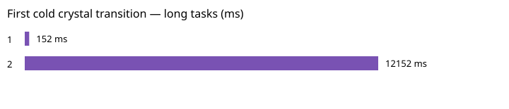

# Level loading measurement

[Tóm tắt kết quả bằng tiếng Việt](kiem-tra-ban-thu.md)

Windows desktop, Intel Core i7-10700, 32 GB RAM, Intel UHD 630 driver 31.0.101.2141; Chrome headless with D3D11, 1180×760 and the default medium quality. Local HTTP server; service worker blocked. Each cold run uses a new browser context; reload uses the same context after resetting the saved level to hub. Browser process and GPU shader caches are shared across runs, so later cold contexts are not fully cold GPU starts. Intro animations are marked seen for repeatability; the script presses W for 300 ms after each transition and records player positions, modal and cutscene state. Input displacement is a coarse control check.

Run `python tools/perf_scenario.py <app-root> <output.json> 5` on the same host with similar background load. The sequential scenario goes hub→1→2→3→4→5→6→1. Add `--from-hub` to return to hub before each target; the last entry is an ocean revisit. Request is sampled immediately before clicking a map card. Build is synchronous builder time; first frame is the first completed `MAY.renderFrame` after build. RAF gap is the largest observer interval intersecting request–first draw. These measurements include automation and rendering and are not presentation timestamps.

## Before — sequential

Samples: 10; user agent: `Mozilla/5.0 (Windows NT 10.0; Win64; x64) AppleWebKit/537.36 (KHTML, like Gecko) HeadlessChrome/158.0.0.0 Safari/537.36`; renderer: `ANGLE (Intel, Intel(R) UHD Graphics 630 (0x00009BC5) Direct3D11 vs_5_0 ps_5_0, D3D11)`.

| Mode | Visit | Median request → first draw (ms) | Median before build (ms) | Median build (ms) | Median / worst RAF gap (ms) |
|---|---|---:|---:|---:|---:|
| cold | Play enabled + ready | 4453 | — | — | — |
| cold | level1 | 727 | 21 | 227 | 653 / 2880 |
| cold | level2 | 928 | 18 | 224 | 880 / 1920 |
| cold | level3 | 654 | 28 | 171 | 627 / 1760 |
| cold | level4 | 930 | 22 | 155 | 907 / 12360 |
| cold | level5 | 1137 | 26 | 234 | 1107 / 3293 |
| cold | level6 | 618 | 40 | 238 | 586 / 1907 |
| cold | level1 revisit | 351 | 18 | 59 | 333 / 427 |
| reload | Play enabled + ready | 4485 | — | — | — |
| reload | level1 | 572 | 18 | 170 | 547 / 693 |
| reload | level2 | 830 | 20 | 164 | 813 / 1000 |
| reload | level3 | 808 | 30 | 161 | 760 / 987 |
| reload | level4 | 887 | 23 | 156 | 867 / 987 |
| reload | level5 | 1019 | 22 | 192 | 987 / 1080 |
| reload | level6 | 853 | 52 | 315 | 813 / 1000 |
| reload | level1 revisit | 422 | 29 | 71 | 413 / 533 |

## After, before the final render fix — sequential

Samples: 10; user agent: `Mozilla/5.0 (Windows NT 10.0; Win64; x64) AppleWebKit/537.36 (KHTML, like Gecko) HeadlessChrome/158.0.0.0 Safari/537.36`; renderer: `ANGLE (Intel, Intel(R) UHD Graphics 630 (0x00009BC5) Direct3D11 vs_5_0 ps_5_0, D3D11)`.

| Mode | Visit | Median request → first draw (ms) | Median before build (ms) | Median build (ms) | Median / worst RAF gap (ms) |
|---|---|---:|---:|---:|---:|
| cold | Play enabled + ready | 1891 | — | — | — |
| cold | level1 | 847 | 168 | 164 | 667 / 2427 |
| cold | level2 | 766 | 84 | 174 | 693 / 933 |
| cold | level3 | 590 | 27 | 176 | 573 / 813 |
| cold | level4 | 630 | 40 | 170 | 560 / 1507 |
| cold | level5 | 1113 | 54 | 195 | 1066 / 1573 |
| cold | level6 | 842 | 95 | 203 | 747 / 1160 |
| cold | level1 revisit | 450 | 24 | 71 | 440 / 507 |
| reload | Play enabled + ready | 1657 | — | — | — |
| reload | level1 | 668 | 142 | 141 | 547 / 907 |
| reload | level2 | 673 | 42 | 149 | 627 / 880 |
| reload | level3 | 654 | 35 | 194 | 573 / 973 |
| reload | level4 | 551 | 30 | 152 | 493 / 1013 |
| reload | level5 | 1033 | 57 | 187 | 947 / 1227 |
| reload | level6 | 810 | 102 | 265 | 693 / 840 |
| reload | level1 revisit | 345 | 26 | 60 | 294 / 520 |

## Before — from hub

Samples: 10; user agent: `Mozilla/5.0 (Windows NT 10.0; Win64; x64) AppleWebKit/537.36 (KHTML, like Gecko) HeadlessChrome/158.0.0.0 Safari/537.36`; renderer: `ANGLE (Intel, Intel(R) UHD Graphics 630 (0x00009BC5) Direct3D11 vs_5_0 ps_5_0, D3D11)`.

| Mode | Visit | Median request → first draw (ms) | Median before build (ms) | Median build (ms) | Median / worst RAF gap (ms) |
|---|---|---:|---:|---:|---:|
| cold | Play enabled + ready | 3953 | — | — | — |
| cold | level1 | 684 | 16 | 195 | 613 / 2733 |
| cold | level2 | 802 | 22 | 186 | 787 / 2147 |
| cold | level3 | 705 | 12 | 137 | 693 / 1626 |
| cold | level4 | 985 | 16 | 140 | 960 / 16319 |
| cold | level5 | 1097 | 13 | 179 | 1080 / 4120 |
| cold | level6 | 679 | 18 | 192 | 667 / 1747 |
| cold | level1 revisit | 431 | 28 | 59 | 413 / 427 |
| reload | Play enabled + ready | 3328 | — | — | — |
| reload | level1 | 656 | 22 | 192 | 573 / 960 |
| reload | level2 | 769 | 21 | 190 | 733 / 880 |
| reload | level3 | 787 | 11 | 112 | 760 / 880 |
| reload | level4 | 1084 | 15 | 128 | 1053 / 1173 |
| reload | level5 | 1180 | 16 | 191 | 1160 / 1267 |
| reload | level6 | 687 | 24 | 210 | 653 / 720 |
| reload | level1 revisit | 383 | 16 | 57 | 360 / 387 |

## After, before the final render fix — from hub

Samples: 10; user agent: `Mozilla/5.0 (Windows NT 10.0; Win64; x64) AppleWebKit/537.36 (KHTML, like Gecko) HeadlessChrome/158.0.0.0 Safari/537.36`; renderer: `ANGLE (Intel, Intel(R) UHD Graphics 630 (0x00009BC5) Direct3D11 vs_5_0 ps_5_0, D3D11)`.

| Mode | Visit | Median request → first draw (ms) | Median before build (ms) | Median build (ms) | Median / worst RAF gap (ms) |
|---|---|---:|---:|---:|---:|
| cold | Play enabled + ready | 1719 | — | — | — |
| cold | level1 | 684 | 164 | 148 | 533 / 2626 |
| cold | level2 | 660 | 45 | 141 | 600 / 907 |
| cold | level3 | 530 | 18 | 167 | 467 / 787 |
| cold | level4 | 512 | 33 | 125 | 480 / 1373 |
| cold | level5 | 940 | 41 | 181 | 867 / 1640 |
| cold | level6 | 714 | 83 | 124 | 613 / 1120 |
| cold | level1 revisit | 341 | 18 | 63 | 320 / 373 |
| reload | Play enabled + ready | 1406 | — | — | — |
| reload | level1 | 669 | 125 | 137 | 547 / 720 |
| reload | level2 | 570 | 77 | 103 | 480 / 493 |
| reload | level3 | 508 | 18 | 126 | 480 / 533 |
| reload | level4 | 578 | 51 | 140 | 507 / 573 |
| reload | level5 | 1009 | 55 | 164 | 907 / 1600 |
| reload | level6 | 549 | 82 | 106 | 467 / 853 |
| reload | level1 revisit | 373 | 21 | 56 | 360 / 427 |

## Final render fix — from hub

Samples: 10; user agent: `Mozilla/5.0 (Windows NT 10.0; Win64; x64) AppleWebKit/537.36 (KHTML, like Gecko) HeadlessChrome/158.0.0.0 Safari/537.36`; renderer: `ANGLE (Intel, Intel(R) UHD Graphics 630 (0x00009BC5) Direct3D11 vs_5_0 ps_5_0, D3D11)`.

| Mode | Visit | Median request → first draw (ms) | Median before build (ms) | Median build (ms) | Median / worst RAF gap (ms) |
|---|---|---:|---:|---:|---:|
| cold | Play enabled + ready | 1640 | — | — | — |
| cold | level1 | 668 | 156 | 141 | 520 / 2293 |
| cold | level2 | 484 | 49 | 131 | 427 / 560 |
| cold | level3 | 415 | 7 | 158 | 387 / 507 |
| cold | level4 | 515 | 32 | 148 | 440 / 1213 |
| cold | level5 | 929 | 35 | 166 | 880 / 1267 |
| cold | level6 | 574 | 90 | 128 | 480 / 880 |
| cold | level1 revisit | 266 | 9 | 65 | 240 / 333 |
| reload | Play enabled + ready | 1422 | — | — | — |
| reload | level1 | 553 | 133 | 117 | 427 / 506 |
| reload | level2 | 407 | 40 | 118 | 347 / 414 |
| reload | level3 | 357 | 7 | 144 | 320 / 400 |
| reload | level4 | 453 | 43 | 110 | 373 / 547 |
| reload | level5 | 842 | 61 | 154 | 800 / 960 |
| reload | level6 | 536 | 90 | 118 | 467 / 627 |
| reload | level1 revisit | 250 | 7 | 55 | 240 / 320 |

## Throttled startup

Five fresh contexts against the updated app before the final render fix, with CDP latency 150 ms, download 1.6 Mbit/s and upload 0.75 Mbit/s; service workers blocked. This is an emulation, not a physical mobile connection. The metric ends when Play is enabled and three animation frames have run.

Median: 31172 ms. Samples: 38985, 31922, 31047, 31172, 31156 ms.

## Crystal long tasks

Bars show browser-reported long tasks overlapping the first cold crystal transition; the chart uses durations, not call stacks. See JSON for timestamps and every sample.

