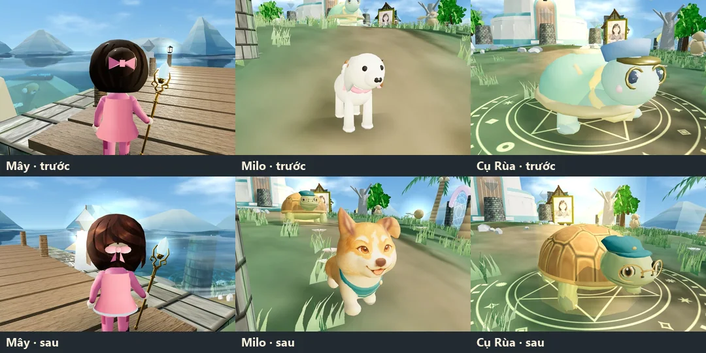

# Mây, các bạn đồng hành và sáu vùng chơi

Đối chiếu với bản `6b0007b`, dùng cùng trình nạp mô hình, ánh sáng và góc máy cho từng cặp ảnh. Ảnh nhân vật dưới đây chụp các mô hình đang hoạt động trên Đảo Mây, với camera đặt gần để đọc được mặt và chất liệu.

## Những bản thử đã bỏ

| Đối tượng | Quan sát khi xoay và chơi | Thay đổi đã chọn |
| --- | --- | --- |
| Mây | Vòng tóc nổi thành từng khoanh xám. Thử gom chúng vào một búi thì camera sau lưng vẫn thấy một đốm tròn sẫm. | Hạ búi xuống sát chiếc nơ. Vẽ lọn tóc lớn, chiếu màu qua cả mái, hai bên và sau đầu. Hạ phản quang, sửa phần gối, cổ váy và mống mắt. Sáu ảnh chọn trang phục được xuất lại từ chính mô hình. |
| Milo | Ở bản đầu, miệng và mắt là những khối rời. Lần chiếu ảnh đầu tiên có đường chuyển màu gắt ở tai, khăn chìm trong ngực. | Dựng một bề mặt liền cho má, mõm, ngực, chân và đuôi. Màu lông được trải lên UV, khăn bám theo đường cổ. Milo thường và Milo có cánh dùng chung mô hình. |
| Gấu và thỏ | Đổi màu và làm trơn bản gốc chưa đủ để nhận ra loài từ xa. Ở lần dựng tiếp theo còn thấy ranh giới giữa các khối tay, chân và thân. | Tạo lại bề mặt liên tục, gán trọng số về xương gốc và vẽ lớp lông riêng. Gấu trúc và gấu Bắc Cực dùng hai nửa của cùng một atlas. Thỏ rừng, thỏ trắng và thỏ tuyết có màu, tai và dáng nhìn nghiêng khác nhau. |
| Cụ Rùa | Mai cũ chỉ có vài mảng vàng nổi trên một vòm xanh. Khi thử hai màu mai mới, màu hổ phách phân biệt được với chân xanh ngay dưới ánh sáng ngoài đảo. | Mai chia tấm có rãnh và vành ôm bụng, gương mặt có mỏ, gọng kính và mũ. Bảy xương và hai clip tiếp tục điều khiển dáng đứng, lời thoại. |

Bướm có hai cánh có gân, xoay ở gốc cánh. Chuột chũi có bàn chân đào đất và móng. Sò ngọc mở ra bằng hai mảnh vỏ có gân tỏa từ bản lề. Các ảnh dưới dùng trình dựng và camera giống nhau cho bản cũ và bản mới. [So sánh bảy con vật, hàng trên trước và hàng dưới sau](thu-va-con-trung.webp).

## Bốn trùm và môi trường

Bạch Tuộc dùng tám tay có xương chuyển động. Bọ Cạp có càng rộng, đốt bụng và đuôi cong về trước. Sói Tuyết có mõm dài, chân và lưng rõ khi chạy. Ở trận cuối, ba cung sét chừa khoảng nhìn thấy mặt Vua Mây Bão. Đã thử phản đạn, dùng Nắng, phối hợp Băng–Nắng và dùng Lốc để xác nhận các đòn vẫn trừ máu. [Bốn trùm ở cùng góc nhìn](bon-trum-truoc-sau.webp).

Sáu vùng mở rộng có sáu tranh toàn cảnh bám theo hướng nhìn. Trên cầu mây, mạch lát so le và hai dải mép cầu chạy theo khúc cong. Các trụ đèn và ban công tạo khoảng ngắt thay cho hàng mái nhọn cách đều. Ở rừng, hang và tuyết, hình dáng và khoảng cách giữa các cụm cây, đá thay đổi dọc tuyến. Mục tiêu và đường đi vẫn nằm trong cảnh 3D có thể điều khiển. [Ảnh trước và sau của sáu hành trình](sau-vung-truoc-sau.webp).

Ở một góc vào cầu trên desktop, chi tiết mới tăng từ 47 lên 50 lượt vẽ và từ 46.158 lên 56.626 tam giác so với lần thử vừa thêm toàn cảnh. Hang ở cùng điểm đo giữ 42 lượt vẽ, giảm từ 19.320 xuống 18.066 tam giác. Đây là chi phí của hai khung hình cụ thể. Các ảnh dọc và thao tác cảm ứng được thử trong Chrome ở 390 × 844. Hiệu năng GPU và nhiệt độ trên điện thoại thật vẫn cần đo.

## Cách dựng và kiểm tra

- Với gấu và thỏ, giữ khung xương và hoạt ảnh Polyfork, dựng lại hình và màu của thú trong game. Sói dùng mẫu Polyfork với vật liệu riêng của trùm. [Nguồn và giấy phép từng mẫu](../assets/models/POLYFORK.md).
- Đã xem phương án dựng 3D trực tiếp từ ảnh. Máy thử dùng Intel UHD 630. Các bản chạy tham chiếu của TRELLIS và TripoSR nhắm GPU NVIDIA/CUDA. Với Milo, dùng ảnh vẽ làm tham chiếu và màu lông, dựng lưới trên CPU bằng marching cubes, giảm tam giác, trải UV và đóng gói lại GLB. Cách này cho phép kiểm tra xương và clip ngay trong game. [TRELLIS](https://github.com/microsoft/TRELLIS) · [TripoSR](https://github.com/VAST-AI-Research/TripoSR) · [glTF Transform](https://github.com/donmccurdy/glTF-Transform).
- Rà danh mục 52 vai thú, quái và sinh vật bằng các hàm tạo thật của game, cùng sáu trùm. Kiểm tra toàn bộ 46 GLB bằng `python -B -X utf8 tools/check_glb.py assets/models`. Có 35 tệp đạt trực tiếp, 11 tệp có cảnh báo, 0 tệp lỗi. Riêng Mây có 8.446 tam giác, 19 xương và 13 clip. Milo có 3.264 tam giác và 5 clip. Mỗi GLB gấu/thỏ có 3.200 tam giác và 3 clip.
- Ba khuôn hình gần trên đảo dùng nhân vật thật. Đã phát từng clip của Milo và Cụ Rùa, kiểm tra việc hiện/ẩn cánh, mở cả sáu trang phục, di chuyển trong sáu vùng và tải lại các gói khi tắt máy chủ. [Cách chạy kiểm tra hành trình](nghiem-thu-sau-chuong.md).

Những điểm còn dễ thấy là viền tóc góc cạnh khi dí sát camera, biểu cảm của nhiều NPC phụ còn ít và một số đá, cây tiền cảnh có ít mặt hơn tranh nền. Chưa có đánh giá độc lập từ trẻ lần đầu chơi hoặc người mua về mức sẵn sàng thương mại.
